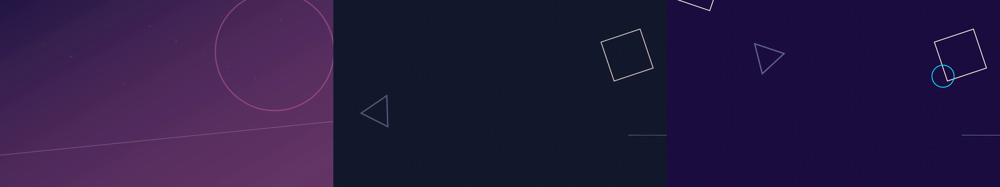

# 共通編集UI（ブラウザで歌詞・シーンを直して MP4 に書き出す）

どのプロジェクトでも使える、ブラウザの編集画面です。特定の曲や特定の PC のフォルダには依存しません。
GitHub からこのパックを入れた人なら、同じ画面を自分の曲で使えます。

## 更新とタブの違い

全編書き出しは元の解像度・fpsが既定です。変更のない素材・書体・描画用ビルドは準備時に再利用し、保存した編集値は毎回読み込みます。初回や素材・書体・色調・描画コードが変わったときは必要な準備をやり直します。対応する8bit H.264動画はWebCodecsで読み込みます。色の情報が不足した動画でも従来と同じ色の解釈になるよう、作業用コピーの情報を補います（再圧縮はせず、元素材・再生時刻・元音声は変えません）。HDR・回転・非正方形ピクセル・未対応形式や準備失敗時は従来方式を使います。従来方式の動画フレームキャッシュは256MBです。新旧方式で微小な圧縮・画素差は残り、速度は内容とPC性能に左右されます。数分での完了を保証する設定ではありません。

診断で従来方式に固定する場合は、エディタを起動するターミナルで環境変数 `MVPACK_VIDEO_DECODER=offthread` を設定します。解除すると対応動画で新方式を使います。

新方式はWindows 11実機で、全編書き出し・元音声の一致・速度変更・ループ・重ね表示・分割画面を確認済みです。173秒のフルHD作品では従来18分9.685秒に対し13分1.559秒（約28%短縮）でした。完了1回ずつの測定で、同じ速度や短縮率を保証しません。macOS/Linuxでの新方式の実機検証は未実施です。

「歌詞」「シーン」「タイミング」「顔の位置」の4タブは常に表示します。補助サーバーが未起動なら、押したときに理由と通常の起動方法を案内します。`--no-tools` は補助サーバーを起動しない設定で、タブを消す設定ではありません。

本体を更新しても、既存プロジェクトにコピー済みの画面は自動では変わりません。`remotion/` で `npm run editor:update -- --all`（1曲だけなら `--project <名前>`）を実行すると、保存した編集データ・素材を変えずに、画面のJS・CSS・書体などを更新できます。補助サーバーはこのコマンドでは起動しません。

画面上部の「エディター」に版の識別値を表示します。更新後、開いたままの画面には再読み込みの案内が出ます。未保存の変更は保存してから再読み込みしてください。自動の再読み込みや未保存内容の上書きは行いません。保存処理の変更も反映する場合は、そのプロジェクトの旧サーバーを終了し、`npm run editor -- --project <名前>` で起動し直して表示されたURLを使います。`editor:update` 自体はサーバーを再起動しません。

## できること
- 歌詞の行の **結合**（次の行をまるごと／一部の文字だけ）と **分割**、開始・終了秒の調整
- シーンの切替秒、フェード秒、画像の位置（-100〜100）と拡大（1〜3倍）
- タイムラインでシーンを **トリム**（シーンの端をドラッグすると、映像ごと頭／お尻を切る・伸ばす。後ろのシーンは映像の使い始め（IN）も一緒に動くので絵がずれない。**Alt＋端をドラッグ** は今までの「切替点だけ動かす」。Ctrl＋ドラッグは今までどおり「そのシーンだけ」。端をクリックしただけでは何も変わりません）、**削除**（Delete キー・右クリック。前のシーンが伸びてすき間を埋める）、**シーン追加**（素材を選んで赤い線の位置に入れる）、**コピー・貼り付け**（Ctrl+C / Ctrl+V）、再生中に赤い線を追いかける **追従 ON/OFF**。どれも Ctrl+Z で戻せます
- リリックモーションの選択（**カタログから自動で一覧化**。基本34・合流/分かれ4・ムード別32・pro-motion の `pro_*` 11・ライブDVD風 `dvd_*` 6 の計87種と、`npm run style:new` で足した独自スタイルもすべて出ます。合流/分かれは `join_left_right` 左右から合流 / `join_top_bottom` 上下から合流 / `leave_left_right` 左右へ分かれる / `leave_top_bottom` 上下へ分かれる）
- **ライブDVD風テロップ**（下の「ライブDVD風テロップ」の節）
- 書体（カテゴリ別。PC に実ファイルがある日本語書体だけを表示）、入り方・消え方・色・角度・配置・文字効果
- 見本を「この行／チェックした行／全行」に適用、取り消し、編集履歴
- 立ち絵モーションMV（`*.tachie.json` のステージ）も開けます。`npm run start` や「立ち絵で」で作ったプロジェクトは `npm run editor -- --project <曲名>` でそのまま開け、MP4 はここから書き出します。行ごとの「ステージの文字スタイル（立ち絵など）」: おまかせ（元の見た目）／縦書き吹き出し／後ろに大きく／下の帯／ポップ／斜めの半透明／中央の縦書き
- 「シーン」タブの下の方で、キャラ・ゲスト・テロップも直せます: キャラの位置・大きさ（このカット。横/縦にずらす・大きさ・左右反転・隠す、「このカットの設定を全シーンへ」「元に戻す」）、ゲスト（出す・のぞき込み・アップ/分割でも出す・最後の集合写真、ゲストごとの名前・大きさ）、のぞき込み（秒・拍数・方向・位置・大きさ、追加・削除）、名前タグ（GUEST）、登場テロップ・名前テロップの追加、間奏テロップ（文字・秒・位置・大きさ・色・帯）、ゲスト紹介
- 保存（`editor-state.json`。保存前の版は `edit-history/` に残る）と、保存した内容での MP4 書き出し

歌詞の本文は変えられません（元の歌詞の欠落・重複・並び替えはサーバー側で拒否します）。

## 動画の一部だけ速度を変える・境界を調整する

対象区間の始まりと終わりで「ここで切る（S）」を押し、中間のシーンだけ選んで速度を変更します。タイムライン上の長さと隣の速度は変わりません。同じ素材が続く場合、「次のカットの使い始めを追従させる」をONにすると次の素材INをつなぎ、OFFなら次のINを固定します。OFFでは境目で素材の時間が飛ぶ・重なる場合があります。再生中の赤線を追いかける「追従 ON/OFF」とは別です。

分割だけならカメラ進行・乱数・滑らかな速度曲線を保持します。「動きをこのシーンの頭から始める」でカメラを仕切り直せます。速度を明示変更した区間ではその設定を使い、素材が足りない場合は末尾を保持します。尺優先の自動調整を選び直すと実速度が変わる場合があります。

開始・終了の数値欄と端ドラッグは、同じ「映像ごとトリム（速度を保つ）」が既定です。素材INを動かさず切替時刻だけ変える場合は「切替時刻だけ（尺を合わせ直す）」を選びます（端ドラッグはAltでも指定可能）。元の映像や演出を保てない結合、フェード中など対応できない位置の分割は理由付きで止まります。

## 映像を2段に重ねる

タイムラインの素材を選び、再生位置を合わせて **「＋上段に重ねる」** を押します。上段は下段のシーンとは別の時間範囲で、下段の切り替わりをまたいで表示できます。追加した上段のブロックをドラッグすると移動し、左右の端をドラッグすると長さを変えられます。Shift を押しながらドラッグすると拍への吸着を外せます。

「重ねる映像を選択」で対象を選び、開始・終了秒、素材の開始秒、位置、幅・高さ、不透明度を調整できます。「画面上で上段を移動」をONにするとプレビュー上で直接動かせます。「縦横比を保つ」は現在の幅と高さの比率を保ちます。位置は各軸−100〜100%、幅・高さは5〜200%で、画面外にはみ出た部分は出力枠で切れます。

素材差替えと動画の速度（0.1〜4倍）も設定できます。差替え時は素材の開始秒が0に戻ります。左端トリムは速度に応じて素材INも動きます。上段同士を重ねる場合は後に追加したものが手前です。上段には画像または動画を使えます。長さ情報がある動画が足りなくなったときは最後の画で止まります。映像の音は使わず、曲を再生します。編集内容は保存後の MP4 にも反映します。歌詞なしのプロジェクトも開いて保存できます。

## ライブDVD風テロップ

ライブの映像ソフト（DVD・Blu-ray）のような、静かで読みやすい文字の見せ方です。「歌詞」タブの右側、「追加テキスト・テロップ」で使います。

歌詞以外の文字を自由に作るときは、種類で「自由テキスト」を選んで追加し、本文を書き換えます。追加した文字は選択後に本文・モーション・書体・位置などを編集できます。映像や画像そのものに焼き込まれた文字は、この操作では書き換えられません。

- **歌詞をライブDVD風にする**: 行を選んで、モーションで「ライブDVD風」の中から **ライブDVD・字幕**（画面下の中央に白い字幕。下だけ少し暗く）を選びます。まとめて変えるときは「見本・設定をまとめて適用」で全行／チェックした行へ。強調色を白以外にすると文字がほんのり光ります。
- **歌詞とは別のテロップを足す**: 種類を選んで「赤い線の位置に追加」。歌詞は変わりません（追加テロップは保存のときの歌詞チェックの対象外です）。
  | 種類 | 本文 | サブ行 | 上の行 | その他 |
  |---|---|---|---|---|
  | 会場カード（左上・赤い線） | 大きい行（会場名など） | 小さい行（会場・日付など） | – | 線の色＝「強調」色 |
  | タイトル（中央） | タイトル | 線の下の行 | 線の上の小見出し | 間隔（秒）＝順に出る間隔。空なら曲のBPMの2拍分 |
  | カメラ表示（四隅の枠・REC・時刻） | 左上の表示 | 開始時刻 `HH:MM:SS`（そこから進む） | 左下の表示 | 時刻のコマ数はプロジェクトの fps |
  | 暗転 | （表示しない） | – | – | 暗さ 0〜1（タイトルやクレジットの下に重ねる） |
  | クレジット | 1行ずつ：`#見出し`＝大きく、`-`＝赤い線、`>注記`＝小さく、`役割\|名前`＝2列、空行＝すき間 | – | – | – |
  | 字幕 | 自由な文字の字幕 | – | – | – |
- どれも「開始秒・終了秒」「出現秒（出てくる時間）」「消える時間（秒）」「文字倍率」「書体」「文字色」が使えます。タイムラインの歌詞の段で、ほかの行と同じようにドラッグできます。
- 追加テロップは **曲の最後の1秒まで** 出せます（エンドクレジット用。普通の歌詞は今までどおり最後の1秒は文字なし）。立ち絵ステージの場面でも表示されます。
- 追加テロップは「このテロップを削除」で消せます。歌詞の行とつなげる・分けることはできません。
- 同じ見た目は `npm run mv` の文字スタイル指定（行・セクションごと）でも `dvd_sub` などの名前で選べます（文字を差しかえるときは params の `text` / `sub` / `pre`）。自動のおまかせでは選ばれません。
- 文字の位置を **左上の角** で決めたいときは、行の `boxX` / `boxY`（画面の幅・高さに対する 0〜1）を `editor-state.json` に書けます。配置ボタン・ドラッグ・「この行の位置を自動に戻す」を使うと外れます。

## 書き出し前に静止画で確認（冒頭3秒のチェック）

MP4 を全部書き出さずに、編集した内容を **書き出しと同じ描画** で静止画にします（`remotion/` フォルダで）。
```bash
npm run editor:stills -- <プロジェクト名>              # 0・1・2・3秒（冒頭のフック確認）
npm run editor:stills -- <プロジェクト名> --at 0,1,2,3,45.5,90 --scale 0.5
```
- 保存済みの `editor-state.json`（未保存の変更は入りません）から作ります。プロジェクト名のほかに、フォルダや `editor-state.json` のパスも指定できます。
- 出力は `projects/<名前>/out/editor/stills-check/`（`--out` で変更）。`still-0_00s.jpg` などと、全部を並べた `sheet.jpg`（FFmpeg があるとき）。
- 冒頭の確認方法は `skills/mv-qa/SKILL.md` の「冒頭と演出の確認」。静止画では構図を見て、動き・拍・同期は音付き動画で確認します。

## 必要なもの
- このパックの `setup`（`remotion/` で `npm install` 済み）
- Node.js 18 以上、Python 3.9 以上（`python3` / `python` / `py` を自動で探します。別の場所なら `MVPACK_PYTHON`）
- 書き出しに Chrome / Chromium と ffmpeg（見つからなければ Remotion 同梱のものを使います。指定は `MVPACK_BROWSER` / `MVPACK_FFMPEG`）
- 素材は **静止画（png/jpg/webp/svg）や動画クリップ（mp4/mov/m4v/webm）＋音源＋時刻つき歌詞 JSON**（立ち絵ステージのプロジェクトはそのまま `--project` で開けます）。動画は `--videos 動画1.mp4,動画2.mov` で追加できます（画像と混ぜてもOK）。動画の音は使わず、曲の音だけが入ります。シーンより短い動画は繰り返し再生します

## 起動（`remotion/` フォルダで）
```bash
# 1) まず見本で試す（8秒の音・画像2枚・歌詞3行を自動で作ります）
npm run editor -- --demo --project editor-demo

# 2) npm run mv（start）で作ったプロジェクトを開く（画像だけの曲なら自動で引き継ぎ用ファイルができます）
npm run editor -- --project <曲名>

# 3) ファイルを直接指定して開く
npm run editor -- --project <名前> --audio 曲.wav --lyrics 歌詞.json --images 画像1.png,画像2.png --videos 動画1.mp4
#   見本: --lyrics editor/sample/lyrics.json --images editor/sample/scene1.svg,editor/sample/scene2.svg
```
表示された `http://127.0.0.1:5195/editor.html` をブラウザで開きます（使用中なら自動で次の番号を使います。変更は `--port 5200`）。

「MP4を書き出す」を押すと、PCの「名前を付けて保存」画面が出ます。保存場所とファイル名を選ぶと書き出しが始まります（キャンセルすれば何もしません）。前回のフォルダは覚えています。
止めるときはターミナルで Ctrl+C。もう一度同じコマンドで起動すると、**保存済みの編集から再開**します。

歌詞 JSON の形: `{"duration": 曲の秒数, "lines": [{"text": "歌詞", "start": 0.4, "end": 2.5}, ...]}`（`song.json` もそのまま使えます）。

## できるファイル（`projects/<名前>/out/editor/`）
- `editor-state.json` … 編集の正本 / `original-source.json` … 元の歌詞・素材（検証用）
- `edit-history/` … 保存ごとの前の版
- `edit-r<版>-<時刻>.mp4` … 書き出し結果（同名 `.json` はその時の設定、`.log` は書き出しログ）
- 元の音源はコピーして保持し、`audio-integrity.json` にハッシュを記録（MP4 の音声は AAC に変換）

## 書体とライセンス
- `npm install` の最後（と編集UIの起動時）に、編集UI用の **29書体** を自動で用意します。すでにあるものは飛ばします。ネットにつながらなくても install は失敗せず、手元の書体だけで使えます（あとで `npm run fonts:editor` で再試行）。
  - Google Fonts の27書体（OFL-1.1 / Apache-2.0。ライセンスを確認してから保存し、ライセンス文も保存）
  - 暗黒工房（作者: maki）の「怨霊」「吐き溜」: **作者の公式サイトから直接**ダウンロードし、ファイルは一切変更しません。リポジトリには入れていません。編集UIで選ぶと作者名と利用条件ページ（https://www.ankokukoubou.com/font/ankokuzonji.htm ）が表示されます。詳しくは `editor/FONT-LICENSES.md`
- 自動ダウンロードを止めたいとき: 環境変数 `MVPACK_SKIP_FONT_DOWNLOAD=1`、または起動時に `--no-font-download`

## 確認済み / 未確認（正直に）
- 確認済み（Linux, 2026-10-27）: 見本での起動、API での保存、不正な保存（歌詞本文の改変）の拒否、再起動後に保存内容が残ること、MP4 書き出し（1280×720 h264 + AAC、8秒）で編集（モーション `pro_pop`・文字色・シーン拡大）が映像に反映されること、ファイル指定版の準備。
- 確認済み（Windows 11 実機, 2026-10）: 編集画面の起動と、MP4 の書き出し。
- 未確認: macOS 実機での起動と書き出し、ブラウザ画面の全操作の手動確認（今回は API とレンダリング結果で確認）、`npm run mv` → `--project <曲名>` の引き継ぎの実曲での通し確認。

## カメラの動き・エフェクト・ビート同期（シーンごと）

「シーン」タブで各シーンを選ぶと、右側に次の項目が出ます。選ぶとそのシーンがすぐループ再生されるので、その場で見比べられます。プレビューとMP4書き出しは同じ描画です。

- **カメラの動き**（32種類）：基本（ゆっくり寄る・左へ流す・ウィップ など）／追加（回り込む・斜めに押し込む・拍でズーム脈動・ダッチ・ピント送り・ゆっくり回転）／プロ仕様（ドリーズーム・スローアーク・手持ち・クラッシュズーム・ウィップパンで入る・クレーン・顔へプッシュイン・2.5D奥行き・スピードランプ・ピント送り＋寄り・ドロップでロール）。速い動きには自動でモーションブラーがかかります。
- **強さ**：弱め（自然）／普通／強め。初期値は「弱め」。
- **ビート**：乗せない（なめらか）／毎拍／2拍ごと／小節ごと／アクセントだけ。
- **エフェクト**（26種類、★は「高級」）：色調、フィルム粒子、グリッチ、フラッシュ、ビネット、シネマ帯、光漏れ、ハレーション、VHS、ぼかし、粒子、反転、画面シェイク／★アナモルフィック・フレア、シネマ・ブルーム、被写界深度、光芒、プリズム分光、フィルムバーン、ティール＆オレンジ、ブリーチバイパス、フィルム調、ガラス屈折、ダスト＆ボケ、光のスイープ。強さとビート同期を1つずつ選べます。
- **一括適用**：「全シーンに適用」「同じ種類のシーンに適用」（例：サビだけ全部）。
- **時間範囲のエフェクト**：開始秒〜終了秒を決めて追加（例：サビの区間だけフラッシュを小節ごと）。

自動で作るとき（おまかせ／半自動／mv）も、Aメロや物語の場面はなめらか・控えめに、サビはビートに乗せて少し強めに、と自動で選びます。日本語でも直せます：「サビはクラッシュズームで」「Aメロのカメラは固定」「サビに光芒」「カメラはビートに乗せない」「全体にフィルム調のエフェクト弱め」。

## 作り終わったらそのまま編集画面へ

start（おまかせ・半自動・こだわり）・`npm run mv` が終わると「いま編集画面を開きますか？ [Y/n]」と聞きます（画像・動画・立ち絵・文字PV（曲と歌詞だけ）のどれでも。開かない場合は `--no-editor`）。文字PVは、`npm run mv` と同じ図形レイヤー（図形・線・粒・区切りの転換・拍のフラッシュ）つきで開きます（直さなければ書き出しも同じ絵）。画像を動画にしたシーンが一部だけでも（残りは静止画）、そのまま開けます。編集画面の上部の「タイミング」「顔の位置」タブから、タイミング調整と顔の位置の修正も同じ画面で開けます（保存は次の `npm run mv` に反映）。

## 日本語の指示と編集画面は「同じ記録」です

`npm run edit -- "サビの歌詞をもっと派手に"` のような日本語の指示は、編集画面の保存先と同じファイル
（`projects/<曲名>/out/editor/editor-state.json`）に書き込みます。

- 画面で手直しした内容（色・書体・位置など）は消えません。指示はその上に重ねて反映されます
- 指示のあとに編集画面を開く（または再読み込みする）と、AI の変更が表示されます
- 変更前の状態は毎回 `edit-history/` に保存されます。`--dry-run` を付けると、変更内容の表示だけで保存しません
- 画面比・ジャンルなど「作り直し」が必要な設定だけは、これまで通り `mv.config.json` に入ります（次の `npm run mv` で反映）

使える言い方の例:

| 言い方 | 変わること |
|---|---|
| 「サビの歌詞をもっと派手に」 | サビの文字を激しい動き＋光彩に |
| 「2番の歌詞を赤に」 | 2番（1回目のサビのあと〜2回目のサビ）の文字を赤に |
| 「全体をゆっくりに」「サビを速く」 | 文字の動きの速さ |
| 「1番のAメロを青に」「最後のサビを大きく」 | 場所を細かく指定 |
| 「Aメロを静かに」「サビはグリッチで」 | 動きの種類 |

場所: 全体 / 1番・2番・3番 / イントロ・Aメロ・Bメロ・サビ・Cメロ（間奏）・アウトロ / 最後のサビ。
色: 赤・ピンク・オレンジ・黄色・金色・緑・水色・青・紫・白・黒。
読み取れなかった指示には、使える言い方の例を日本語で表示します。

## Mac で使うとき（Linux で同じ手順を確認済み・Mac 実機は未確認）

Mac 実機でのテストはまだですが、Mac と同じ仕組み（POSIX のパス・`setup.sh`・`start.sh`）を Linux で一通り確認しました:
セットアップ → 編集画面の起動 → 画面で保存 → 日本語の指示 → 開き直して反映を確認 → 動画クリップ入りの6秒の書き出し（H.264＋AAC）。

Mac で準備が必要なもの:

1. **Node.js**: https://nodejs.org の LTS 版、または `brew install node`
2. **ffmpeg（フル版）**: `brew install ffmpeg`（Homebrew が無ければ https://brew.sh ）。ffprobe も一緒に入ります
3. **Chrome**: 書き出しは `/Applications/Google Chrome.app` を自動で使います。無い場合は Remotion が初回に専用ブラウザを自動ダウンロードします（ネット接続が必要）。別の場所なら `MVPACK_BROWSER`
4. **Python 3**: Mac 標準の `python3` で動きます（初回にコマンドライン・デベロッパツールのインストールを求められたら「インストール」）。Homebrew の Python は `pip install` を禁止しているため、`setup.sh` がパックの中に専用の環境（`.python-deps/venv`）を作って任意部品を入れます。パックは自動でそちらを使います
5. 初回に `./setup.sh` を実行（ダブルクリックで開けない場合はターミナルで `bash setup.sh`）。「開発元が未確認」と出たら、システム設定 → プライバシーとセキュリティ で許可してください

## テストに必要な追加ツール

`npm test` の一部は、追加ツールが無いと自動で **スキップ** します（失敗ではありません。理由と入れ方が表示されます）:

- **ffmpeg のフル版と ffprobe**（音声の切り出し、口パク用の再切り出し、動画クリップの取り込み）
  - Mac: `brew install ffmpeg` / Windows: `winget install Gyan.FFmpeg`（essentials ではなく full 版）/ Ubuntu: `sudo apt install ffmpeg`
- **numpy と Pillow 入りの Python**（パーツ分割、動画クリップの品質チェック）
  - `./setup.sh`（Windows は `setup.bat`）を実行するか、`python -m pip install -r requirements_optional.txt`
- OpenCV が一部だけ入っている環境でも、顔チェックだけを「未実行」として続行します

## 文字PVの図形レイヤー（図形・線・粒）を直す

シーンタブの「図形レイヤー（動画全体）」と「図形レイヤー（このシーン）」で直せます。シーンの設定は全体の設定より優先されます。

| 項目 | できること |
|---|---|
| 表示 | オン・オフ（オフでも背景の色は残る） |
| 図形の種類 | なし／色ブロック／幾何学／同心円バースト＋拍の粒／UI・照準／短冊／斜めの線 |
| 区切りの転換 | カット／円・矩形・波紋・雲・文字の中へ・文字で押し出し・斜めスイープ・ゆっくりワイプ |
| 色 | 背景・図形・差し色・サブの4色 |
| 強さ（濃さ）・動きの速さ・量（数） | 0〜2倍・0.25〜3倍・0〜3倍（1倍＝元のまま） |
| 元に戻す | その範囲の変更を消して元の設計に戻す |

- 元の設計（`npm run mv` が作った `mograph`）は書き換えません。変更は `mographEdit`（全体）と各シーンの `mograph` に保存され、`original-source.json` と比べて「直した所」として記録されます（✎ 印）。
- プレビューと MP4 書き出しは同じ描画です。何も直さなければ `npm run mv` の図形レイヤーと同じ絵になります。
- 歌詞の拍アクセント（文字のバンプ・揺れ）は、編集画面では歌詞の動きの設定で直します。



## JIZURAの文字演出を使う

編集画面の「JIZURA 文字演出」を開いてオンにすると、歌詞と開始時刻を使ってJIZURAエンジンが文字の配置・動き・装飾を作ります。スタイル、背景、動きと装飾の強さ、構成番号を変更でき、歌詞ごとに字組み・登場・保持・退場を指定できます。保存した設定は同じ編集画面の書き出しにも使われます。JIZURAはMITライセンスで、著作権表示と全文は `remotion/vendor/jizura/LICENSE` を参照してください。

歌詞の開始・終了時刻、書体・位置・文字倍率を反映し、時間が重なる歌詞は別々に重ねて描画します。JIZURAの字組みの表示範囲を複数時点で測り、指定位置を基準に画面内に収めます。見切れを演出として使う場合は「文字を画面内に収める」をオフにします。複雑な動きは測定の合間に画面端へはみ出す可能性があるため、再生して確認してください。通常モーションの種類はJIZURAには反映されません。画像・動画の上に重ねるか、JIZURAの背景を使うかを選べます。通常モーションに戻すにはオフにします。実際の曲で同期と視認性を確認してください。

歌詞ごとに「この行のガチャ結果を固定」を選ぶと、全体の構成番号を変えてもその行の自動選択を保ちます。「この行だけ別の案」はその行の構成番号だけを変更します。字組み・登場・保持・退場に指定がある場合、その指定は優先されます。色を編集した行は編集画面の文字色・強調色・縁取り色をJIZURAの配色へ渡します。行ごとの色の選択でJIZURAスタイルの色に戻すこともできます。演出によって色の使い方が異なり、縁取り色は補助色として使われるため、通常モーションと同じ縁取りにはならない場合があります。選択した書体や色、時間の変更は固定した演出にも反映されます。

JIZURAの詳細は「選択中の歌詞」の中から開けます。共通欄の「この行の見せ方」で、JIZURAと通常のリリックモーションを行ごとに切り替えられます。JIZURAが無効なプロジェクトで一行だけJIZURAを選ぶと、他の行は通常モーションのままです。「JIZURAを使う」のチェックは全体の有効・無効を切り替えます。JIZURAの角度・影・光彩・二重・色ずれ・縁取りや入り方／消え方は、文字と装飾を含む字組み全体に適用されます。画面内に収める場合は角度を考慮して縮小・配置します。通常モーションの種類はJIZURAには適用されません。「中央」「タイプ」の字組みでは「改行しない」を使えますが、それ以外の字組みを指定した手動パートを含む場合や、他の字組みでは使えません。

「見本・設定をまとめて適用」で「組み合わせ・見た目すべて」を選ぶと、共通の文字設定（位置・改行しない・不透明度を含む）、JIZURAの字組み・入り方・保持・消え方・装飾・カメラ・背景・切り替え、文字効果・画面効果も適用されます。効果開始時刻は対象行の長さに合わせます。各行の本文、開始・終了時刻、手動パート、ランダムの固定値は保持されます。通常モーションの見本や一括適用・詳細表からの変更では、描画方式も通常へ切り替わります。手動JIZURAパートは戻すために保持します。直後なら「直前の一括適用を戻す」で元に戻せます。

行全体の字組み・登場・保持・退場を明示変更すると、手動パートにも反映されます。その後、パートごとに個別指定できます。歌詞の分割・結合では元歌詞への対応と手動パートの文字を保ちます。対応不明な文字や24パートの上限超過は変更前に止まります。重なる行の結合ではパートを新しい区間へ順に配置するため、歌唱との同期を確認してください。

プレビュー下の「プレビューで調整」を押すと、映像の上に選択中の歌詞の調整欄が開きます。大きさと角度はスライダーで変更し、「画面をドラッグして移動」をオンにすると位置をドラッグできます。通常モーションとJIZURAで共通の設定に反映されます。調整欄は書き出した映像には入りません。文字を囲む枠や角のハンドルをドラッグして変形する機能ではありません。

「前の歌詞からの切り替え」と「画面全体の効果」は、選択中の歌詞の共通欄で設定できます。切り替え時間は次の行で0.1〜2秒に指定できます。空欄なら演出ごとの既定値です。歌詞が短い場合、次の行の長さの45％を上限として実際の切り替え時間を短くします。共通の切り替えは通常モーションとJIZURAの間にも使えます。

切り替えが使えない場合は、設定欄に理由を表示します。前の行との間隔や重なり、JIZURA専用の切り替えに通常モーションが含まれる場合などは、案内に従って時刻または切り替えの種類を調整してください。

行ごとの字組み・登場・保持・退場に加え、文字の質感・文字演出のカメラ・装飾・背景グラフィック・切り替えをJIZURAの登録一覧から選択できます。装飾は自動／なし／1種類を選べます。ここでのカメラは文字演出だけに効き、背景動画のカメラを操作するものではありません。背景グラフィックは「JIZURAの背景」を選んだ場合に表示します。行内パート間の切り替えは隣接する十分な長さのパートに適用します。「前の歌詞からの切り替え」は時刻が接している行同士で使えます。共通のクロスフェード・ワイプ・スライド・ズームは通常モーションとJIZURAの間にも使用でき、JIZURA固有の切り替えはJIZURA同士に限ります。文字演出の効果は種類・行開始からの秒数・強さを設定でき、背景映像にはかかりません。別の「画面全体の効果」はフラッシュ・反転・ぼかし・揺れを映像と文字にかけられます。JIZURAの出現秒は編集したときに各パートの長さに収まる範囲で反映します（切り替えなどを優先する場合あり）。

### 表示パートと最後の全文表示

「JIZURA 文字演出」で歌詞を選ぶと、「最後に全文を表示」を自動／表示する／表示しないから選べます。自動を選ぶと、これまでどおりJIZURAが決めます。

細かく決めるには「現在の分割を編集」を押し、取り込んだパートの文字、開始・終了、字組み、登場・保持・退場を直して「パートを反映」します。「＋表示パート」「＋全文」、削除、前との入替も使えます。プレビューに反映後、エディタ上部の「保存」で保存します。書き出しは保存した設定を使います。元の歌詞本文は変わりません。

時刻は**その歌詞行の開始からの秒数**で、1行あたり1〜24パートです。同じ行のパートは時間順で、互いに重ならないようにします。タイムラインの端・開始終了の数値・詳細表で行を伸縮すると、手動パートと効果開始時刻も新しい行尺に比例して伸縮します。行全体の移動は内部の相対時刻を保ちます。JSONを直接編集する場合はパート時刻が行内に収まるよう調整してください。手動パートがある間はその一覧が全文再掲の設定より優先されます。「分割を自動に戻す」で手動パートを外せます。歌声との一致は再生して確認してください。

## JIZURA 字面へ歌詞を渡す

JIZURA は別のブラウザアプリです。現在の編集画面の歌詞と開始時刻を LRC にして、JIZURA に渡せます。

```sh
npm run editor:jizura -- "../projects/曲名/out/editor/editor-state.json" "../projects/曲名/out/jizura-lyrics.lrc"
```

新しいファイル名を指定してください（既存ファイルは上書きしません）。[JIZURA](https://jizura.net/) の「LRC を読み込む」で歌詞を読み込み、同じ曲の音源を選びます。自動推定の時刻は仮なので、歌唱と照合して直してください。

LRC で渡せるのは歌詞と開始時刻です。元の画面の文字配置・モーション・重なった表示時間は引き継がれません。JIZURA の構成は JIZURA の保存ボタンで別に保存します。これは別アプリへの受け渡し方法です。エディタ内のJIZURAエンジンを使う場合は、上記「JIZURAの文字演出を使う」を参照してください。


## 歌声・拍の同期を確認する

新規制作では歌詞の時刻が入力済みの場合も、利用できるローカル音声認識モデルで歌声との照合を試し、拍の目安を曲の３区間で比較して `out/sync-audit.json` に記録します。元の歌詞時刻や手動ロックは書き換えません。利用できるモデルが無いときは未実施として記録し、勝手に取得しません。

既存の編集データも `remotion/` で次のコマンドから確認できます。

```sh
npm run sync:review -- "../projects/曲名/out/editor/editor-state.json"
```

結果は `editor/sync-review/sync-audit.json` に保存します。歌声認識が苦手な歌唱や伴奏、繰り返しでは誤検出や補間があります。音の立ち上がりは拍と限りません。自動の指摘は調整候補であり、音付きで歌声の入り・語尾と拍を確認してください。聴取されていない結果は聴取未確認です。歌詞の修正は既存のエディタや `npm run timing` で行います。


## 音から取る拍

新規制作では音の立ち上がりを追い、拍の間隔が変化する候補を `out/beat-track.json` に記録します。カバー範囲や急な飛びが基準を満たすときは、カットとエディタの拍に自動使用します。安定しない場合はBPMによる仮の拍に戻し、候補を残します。手動指定した拍・BPMロックは優先されます。

エディタの「音から取った拍の確認・修正」で拍の秒数を編集し、保存後のエディタ書き出しに反映できます。空欄にすると等間隔BPMに戻ります。拍の自動推定は誤る場合があり、音で確認してください。推定の範囲外は端の拍間隔で補います。一部の立ち絵やモーショングラフィックスは一定BPMのままです。エディタでの拍の変更はエディタの保存と書き出しに反映され、`npm run mv` の設定ファイルには自動反映されません。
