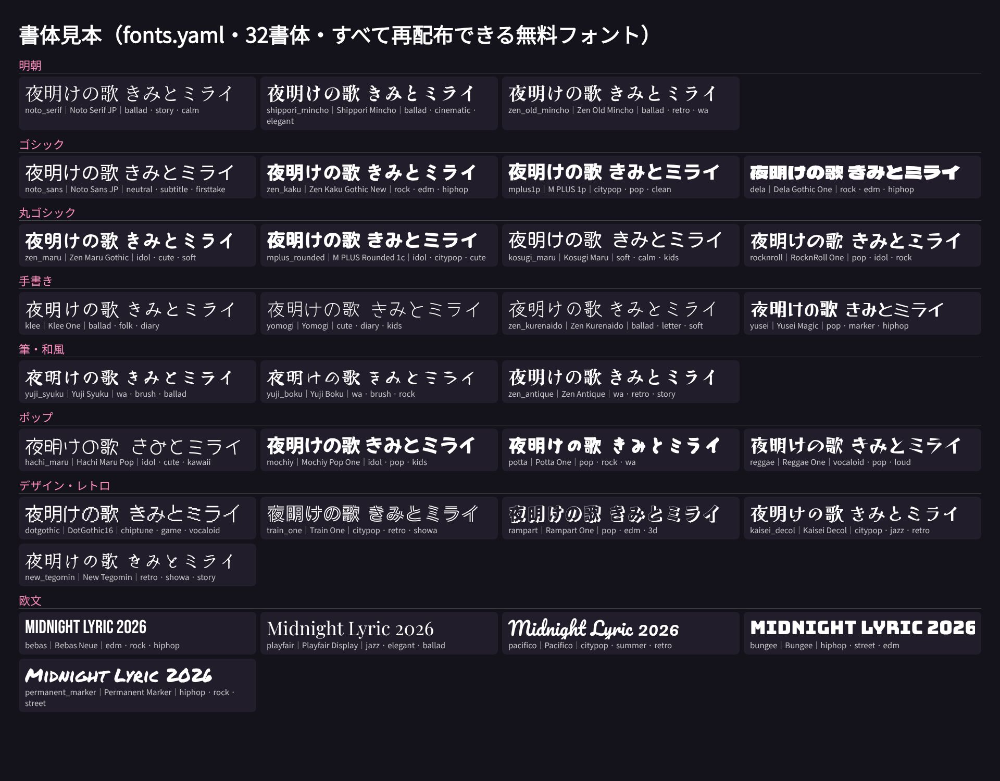

# 書体ガイド（雰囲気 → 書体）

パックには、**再配布できる無料フォント（SIL OFL 1.1 / Apache 2.0）を32書体**入れています。登録簿は `fonts.yaml`、ライセンス文は `remotion/public/fonts/`（`OFL_*.txt` / `LICENSE_*.txt`）にあります。
- 4書体（Klee One・Yuji Boku・Zen Antique・New Tegomin）は容量の都合で同梱していません。`setup.bat`（中で `npm run fonts:fetch`）を実行すると Google Fonts から自動で入ります。
- 入っていない書体を指定した場合は、同じ分類の書体で代わりに表示します。

## 雰囲気から選ぶ
| 曲の雰囲気 | おすすめ | 言い方の例 |
|---|---|---|
| バラード・切ない・物語 | Shippori Mincho / Noto Serif JP（明朝）、Klee One（手書き） | 「明朝で」「手書きの字で」 |
| ロック・EDM・激しい | Dela Gothic One / Zen Kaku Gothic New（極太ゴシック）、Bebas Neue（英字） | 「極太の字で」 |
| シティポップ・ジャズ・夜 | M PLUS 1p、Kaisei Decol（レトロ）、Pacifico / Playfair Display（英字） | 「おしゃれな字で」「レトロな字で」 |
| アイドル・ポップ・かわいい | Zen Maru Gothic / M PLUS Rounded 1c（丸ゴシック）、Mochiy Pop One、Hachi Maru Pop | 「丸っこい字に」「かわいい字で」 |
| 和風・和ロック・祭 | Yuji Syuku / Yuji Boku（筆）、Zen Antique、Zen Old Mincho | 「筆文字で」「和風の字で」 |
| ヒップホップ・ストリート | Dela Gothic One、Yusei Magic（マーカー）、Bungee / Permanent Marker（英字） | 「マーカーっぽい字で」 |
| ゲーム・チップチューン・ボカロ | DotGothic16（ドット）、Reggae One、Rampart One（立体） | 「ドットの字で」「立体的な字で」 |
| 昭和・レトロ | Train One、New Tegomin | 「昭和っぽい字で」 |
| 普通の字幕・ファーストテイク風 | Noto Sans JP | 「普通の字で」 |

## 範囲の指定（Codex に日本語で）
- 曲全体: 「丸っこい字にして」
- セクション: 「サビは筆文字で」「2番のAメロは明朝で」
- 行: 「3行目は明朝で」「『さよなら』の行は手書きの字で」
- 言葉だけ: 「『キライ』は極太の字で」
- 元に戻す: 「書体を元に戻して」（文字スタイルごとの既定の書体に戻ります）

## 自分の書体を足す
- `npm run fonts:add -- "Google Fonts の名前"`: ライセンスを自動で確認します（OFL / Apache / UFL 以外は入れません）。
- `npm run fonts:add -- C:\fonts\MyFont.ttf --license OFL-1.1 --category 手書き`
  - **ライセンスは自分で確認してください。** 商用 MV に使ってよいか、配布してよいかは書体ごとに違います。
  - 未確認のままだと `bundled: false` になり、配る用のパックには入りません。
- 見本を作り直すとき: `npm run fonts:sheet`
